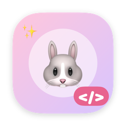
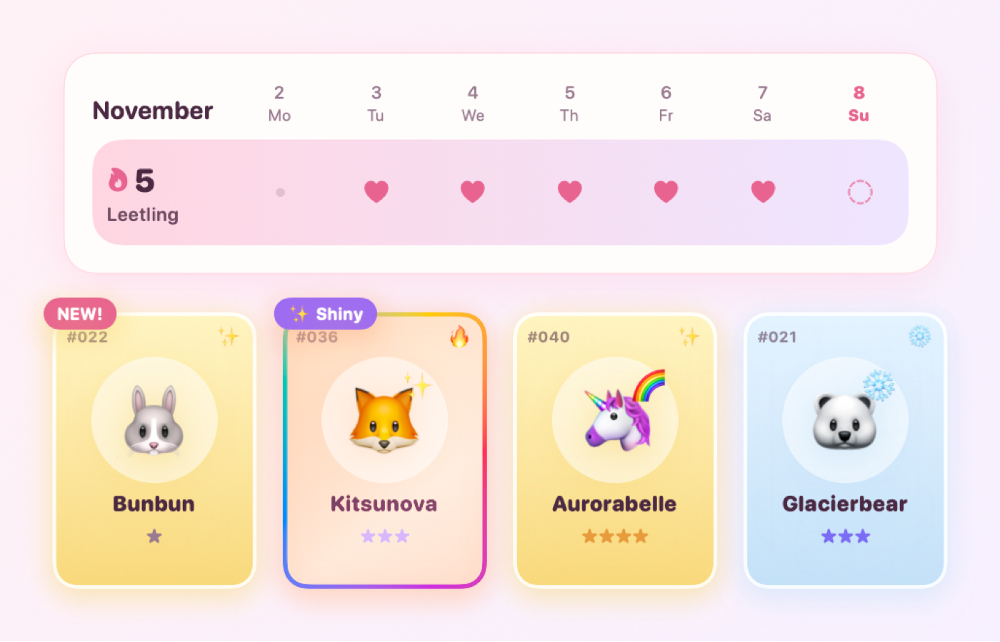

<p align="center">
  
</p>

<h1 align="center">Leetling 🐰✨</h1>

<p align="center">
  A cozy little macOS app for practicing the <b>Blind 75</b> LeetCode problems, one day at a time.<br>
  Solve problems in a built-in Python editor, keep your streak going, and collect cute critters along the way.
</p>

<p align="center">
  
</p>

## Why?

Grinding LeetCode alone in a browser tab is not exactly motivating. Leetling turns it into a daily habit with a soft, pastel, game-like loop:

**solve a problem → keep your streak 🔥 → earn packs 🎁 → collect & evolve Leetlings 🐣**

## Features

- **All 75 Blind 75 problems**, grouped by topic (Arrays & Hashing, Two Pointers, Trees, Graphs, DP, …), each with examples, constraints and 3 hints.
- **Solve inside the app.** A Python editor with syntax highlighting, line numbers and auto-indent. **Run** (⌘R) tries the examples; **Submit** (⌘↩) judges your code against every test, including hidden ones, and shows your `print()` output. Everything runs locally; no browser, no account.
- **Three ways to practice:**
  - 🌱 **Easy First** – all the Easys, then Mediums, then Hards
  - 📚 **By Topic** – work through one category in order
  - 🎲 **Random** – a surprise problem each day (shuffle if it's not vibing)
- **Hints instead of Googling.** Three tiered hint buttons: 🌱 *Nudge* → 🌷 *Approach* → 🌸 *Almost there*. The reference solution unlocks after you pass, or after all three hints.
- **Desktop widget.** A weekly check-in card (or a small streak widget) that shows which days you practiced and your current 🔥 streak.
- **Collect Leetlings.** 46 original critters across 8 elements and 4 rarities, with rare ✨ shiny variants. Get 3 of the same one to evolve it, and pick a favorite as your buddy.

## Rewards

| Do this | Get this |
|---|---|
| Solve a problem for the first time | 🌱 **Sprout Pack** (3 cards) |
| Hit your daily goal (1–4 problems, your choice) | 🌷 **Bloom Pack** (4 cards, last one Uncommon or better) |
| Reach a streak milestone (3, 7, 14, 21, 30… days) | 🌟 **Starlight Pack** (5 cards, last one Rare or better) |
| Finish every problem in a topic | 🌟 **Starlight Pack** |

There are no penalties: using hints or peeking at a solution never costs you anything. 💖

## Install

**You'll need:**
- macOS 14 (Sonoma) or newer
- Apple's Command Line Tools: `xcode-select --install` (full Xcode is **not** required)
- Python 3, e.g. from [python.org](https://www.python.org/downloads/) or `brew install python`

**Then:**

```bash
git clone https://github.com/laylachenn/leetling.git
cd leetling
scripts/build.sh
```

This compiles the app and its widget, signs them locally, installs **Leetling** into `~/Applications`, and opens it.

**Add the widget:** right-click your desktop → **Edit Widgets…** → search **Leetling** → drag the small or medium widget onto your desktop. (If it doesn't show up right away, launch Leetling once, then try again.)

> Prefer something that floats on your desktop instead? Turn on **Settings → Floating desktop buddy**.

## On your iPhone (web app)

Leetling also runs as a web app (`web/`), so you can practice on your phone. Your Python runs right in the browser through [Pyodide](https://pyodide.org), using the same judge and tests as the Mac app.

- **Online:** it deploys to GitHub Pages on every push to `main` (`.github/workflows/pages.yml`). Open the Pages URL in **Safari**, then tap **Share → Add to Home Screen**. It opens full-screen and works offline after the first run.
- **Locally:** `scripts/serve_web.sh` serves it at `http://localhost:8000`. It also prints a URL you can open from an iPhone on the same Wi-Fi.
- **Progress** stays on each device. **Settings → Your data** exports and imports it in the same format as the Mac app's `progress.json`, so you can move progress between them.
- There's no iPhone widget (web apps can't make one), but the Today screen has the same weekly streak card.

## Keyboard shortcuts

| Shortcut | Action |
|---|---|
| ⌘R | Run the example tests |
| ⌘↩ | Submit |
| ⌘/ | Comment / uncomment lines |
| Tab / ⇧Tab | Indent / dedent |
| Esc | Back to the list |

## How it's built

- **SwiftUI** app + **WidgetKit** extension, built with Swift Package Manager and a small shell script, so no Xcode project.
- A **Python test runner** (`Resources/runner.py`) judges solutions LeetCode-style. It builds linked lists, trees, graphs and design-class call sequences from the test data, enforces a per-test time limit, and accepts any valid answer for problems with more than one correct output.
- The problem catalog lives in `content/` as Python. `content/build_problems.py` generates `Resources/problems.json`, computing every expected output by running a reference solution through the real runner and verifying it against hand-checked examples, so the tests can't drift from the answers.

```
Sources/Leetling/        the app (views, game logic, code runner)
Sources/LeetlingWidget/  the desktop widget
Sources/LeetlingShared/  theme + streak card shared by both
Resources/               problems.json, runner.py, app icon
content/                 problem catalog + build/validation script
scripts/build.sh         build → sign → install
```

**Editing problems:** change a file in `content/`, then run `scripts/build.sh --content` to regenerate and re-validate everything.

Your progress is saved locally in `~/Library/Application Support/Leetling/`.

## Notes

- Problem descriptions are written in my own words. LeetCode is a trademark of its owner, and this project isn't affiliated with or endorsed by LeetCode.
- The Leetlings (names, flavor text and designs) are original to this app.
